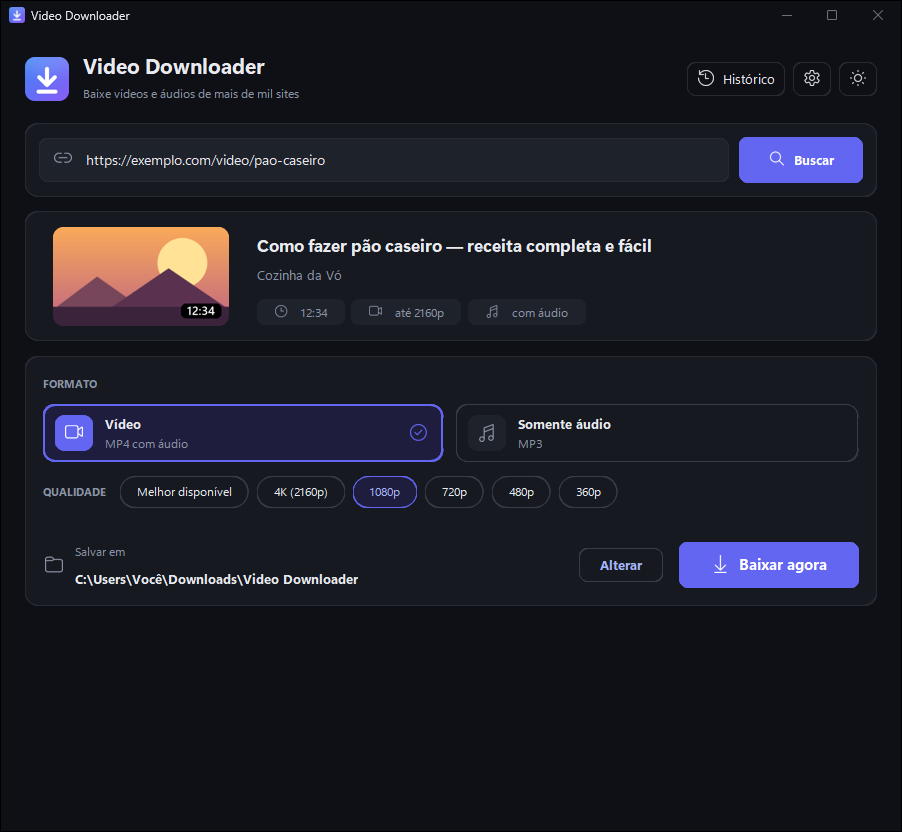
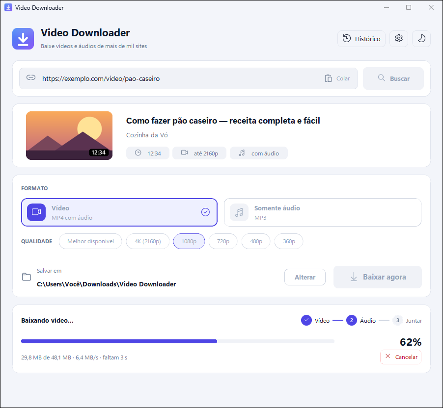
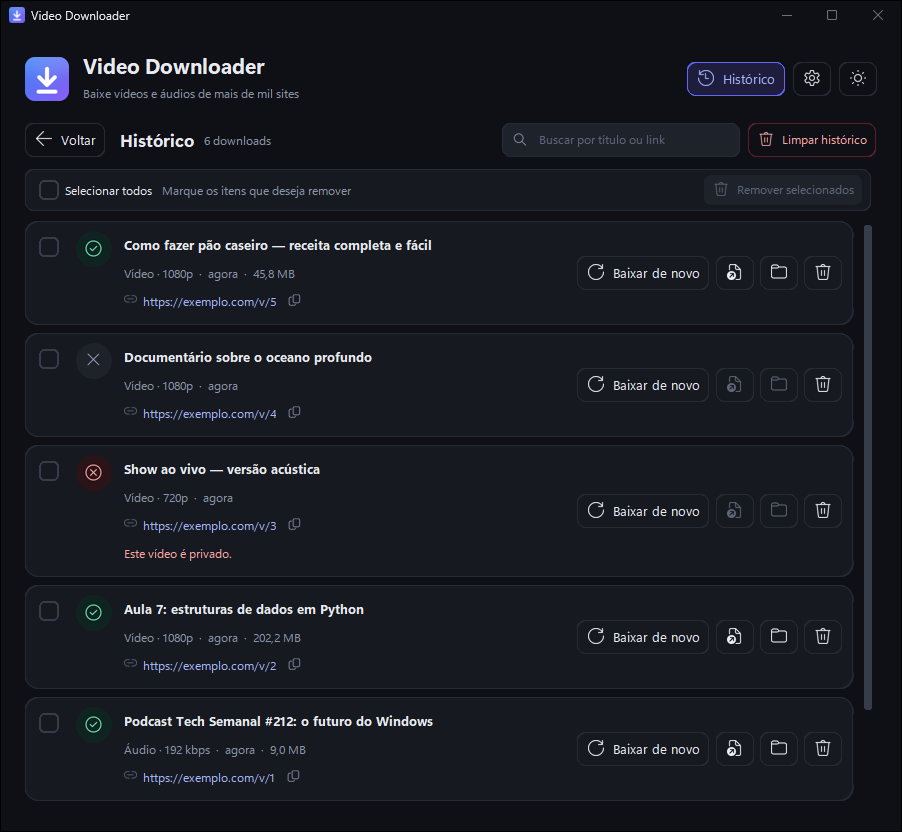
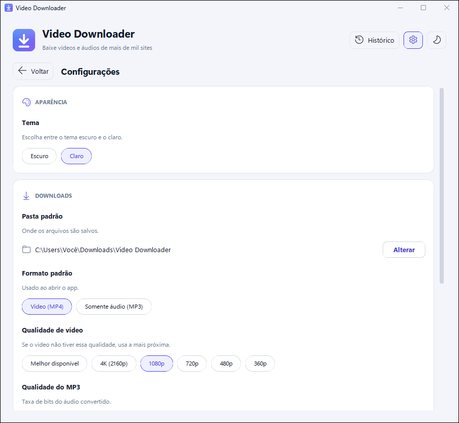

# Video Downloader

Baixe vídeos e músicas de mais de mil sites no Windows, sem linha de comando: cole o link, escolha o formato e clique em
**Baixar agora**.



**[⬇ Baixar a versão mais recente](../../releases/latest)** · Windows 10 e 11 (64 bits) · tema escuro e claro

## O que ele faz

- **Vídeo em MP4** (com áudio) na qualidade que você escolher, de 360p até 4K, ou **só o áudio em MP3**.
- Mostra título, canal, duração e miniatura antes de baixar.
- Progresso com velocidade e tempo restante; dá para cancelar a qualquer momento.
- **Histórico** com busca: abrir o arquivo, abrir a pasta, baixar de novo ou remover.
- Avisa quando há uma versão nova do yt-dlp (o motor de download) e atualiza com um clique, para continuar
  funcionando quando os sites mudam.
- Tudo já vem junto (FFmpeg incluído): não precisa instalar mais nada.

| Baixando | Histórico | Configurações |
|---|---|---|
|  |  |  |

## Como instalar

Baixe na [página de downloads](../../releases/latest) (em **Assets**). Há duas opções:

- **Instalador** (`VideoDownloader-0.1.0-instalador.exe`): dois cliques e pronto. Instala só para o seu usuário, sem
  pedir senha de administrador, e cria atalhos no menu Iniciar e (se quiser) na área de trabalho.
- **Versão portátil** (`VideoDownloader-0.1.0-portatil.zip`): descompacte onde quiser (até num pendrive) e abra
  `VideoDownloader.exe`. Configurações e histórico ficam na pasta `data`, ao lado do programa.

**Na primeira vez, o Windows pode mostrar "O Windows protegeu o computador".** Isso acontece porque o app não tem
uma assinatura digital paga. Clique em **Mais informações** e depois em **Executar assim mesmo**.

## Como usar

1. Copie o link do vídeo (no navegador) e clique em **Colar**, ou cole com `Ctrl+V`.
2. Clique em **Buscar**: aparecem a miniatura e as informações.
3. Escolha **Vídeo** ou **Somente áudio** e a qualidade.
4. Clique em **Baixar agora**. Ao terminar, use **Abrir arquivo** ou **Mostrar na pasta**.

A pasta de destino e as qualidades padrão mudam em **Configurações** (ícone de engrenagem).

## Onde ficam seus dados e como desinstalar

- Instalado: o programa fica em `%LOCALAPPDATA%\Programs\Video Downloader` e as configurações, o histórico e os
  logs em `%APPDATA%\Video Downloader` (mantidos ao atualizar).
- Para desinstalar: **Configurações do Windows → Aplicativos → Aplicativos instalados → Video Downloader →
  Desinstalar**. O desinstalador pergunta se você quer apagar também configurações e histórico. Os vídeos e músicas
  que você baixou **nunca** são apagados.
- Versão portátil: basta apagar a pasta.

## Uso responsável

Baixe apenas conteúdo que você tem direito de baixar (seu próprio conteúdo, domínio público, licenças livres ou com
autorização do autor) e respeite os termos de uso de cada site.

## Conferir o download (opcional)

Cada arquivo tem um `.sha256` ao lado. No PowerShell:

```powershell
Get-FileHash .\VideoDownloader-0.1.0-instalador.exe
```

O valor deve ser igual ao do arquivo `.sha256` correspondente.

## Componentes

Usa [yt-dlp](https://github.com/yt-dlp/yt-dlp) (Unlicense), [FFmpeg](https://ffmpeg.org) (LGPL 2.1, build de
BtbN), [deno](https://deno.com) (MIT), CustomTkinter (MIT), Python (PSF) e outras bibliotecas. Os textos das
licenças vão junto com o programa, em `_internal\bin\licenses`.

Este repositório contém apenas os arquivos para download.
